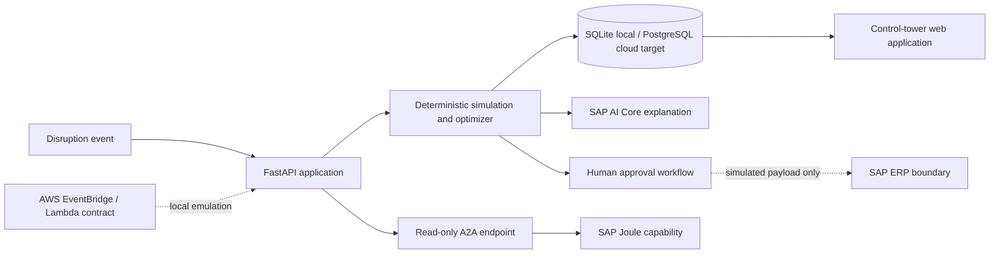

# Nusantara Supply Resiliency Agent

**NSRA** is a decision-support control tower for inter-island supply disruptions in Indonesia. It converts a logistics incident into a time-phased inventory risk assessment, compares bounded mitigation scenarios, prepares a simulated response package, and preserves a human approval and audit trail.

The current system is an implementation-ready prototype: the deterministic decision workflow, professional web interface, Cloud Foundry deployment, SAP AI Core explanation boundary, and SAP Joule A2A capability have been implemented and verified at different levels. Operational data remains synthetic, AWS ingestion is locally emulated, and SAP ERP writeback is deliberately disabled.

> **Safety boundary:** NSRA does not create a purchase order, stock transfer, or any other real ERP transaction. Approval changes simulated application state only.

## Project context

- **Competition:** SAP–AWS Agentic AI Hackathon 2026
- **Track:** Intelligent Supply Chain
- **Team:** A Cruel Angel's Thesis
- **Repository:** [primeell/nusantara-resilience-supply-agentic](https://github.com/primeell/nusantara-resilience-supply-agentic)

## What the application covers

- Executive exposure overview with portfolio KPIs and operational change briefing.
- Interactive Indonesia supply-network map for facilities, ports, routes, delays, and response options.
- Incident portfolio with filtering, sorting, pagination, and CSV export.
- Hourly inventory projection with safety-stock threshold and stockout window.
- Baseline-versus-response scenario comparison and cost-versus-downtime frontier.
- Mitigation allocation composition and incident-to-production impact chain.
- Human approval inbox with separation-of-duties validation.
- Searchable audit trail and integration-health view.
- Read-only A2A endpoint for grounded SAP Joule briefings.
- Optional SAP AI Core explanation constrained by deterministic results.

## System at a glance



Numerical truth stays in Python. The language model may explain an already computed recommendation, but it cannot alter scenario IDs, quantities, cost values, feasibility, or evidence references.

## Current implementation status

| Area | Current status |
|---|---|
| FastAPI workflow and control-tower UI | Implemented and locally verified |
| Deterministic inventory simulation and scenario optimizer | Implemented and covered by automated tests |
| Local state persistence | SQLite, durable across local restarts |
| PostgreSQL repository and migration tooling | Implemented locally; managed cloud database still pending |
| SAP BTP Cloud Foundry application | Public endpoint healthy; deployed revision currently uses ephemeral SQLite |
| SAP AI Core | Controlled live inference previously verified; public live requests disabled by policy |
| SAP Joule | A2A capability previously verified in the tenant; public agent card is reachable |
| AWS event ingestion | EventBridge/Lambda contract locally emulated; no live AWS resource verified |
| SAP S/4HANA writeback | Not implemented; simulated payload boundary only |
| Automated test suite | 86 tests passed on Python 3.12.9; latest evidence is in `docs/EVALUATION.md` |

The detailed evidence, dates, and known gaps are maintained in [Implementation Progress](docs/IMPLEMENTATION_PROGRESS.md) and [Integration Status](docs/INTEGRATION_STATUS.md).

## Quick start on Windows PowerShell

### Prerequisites

- Windows PowerShell 5.1 or PowerShell 7+
- Python 3.11, 3.12, or 3.13
- Git
- Internet access only for the first dependency installation

### First-time setup

```powershell
Set-Location C:\nusantara-supply-agent
py -3.12 -m venv .venv
.\.venv\Scripts\python.exe -m pip install --upgrade pip
.\.venv\Scripts\python.exe -m pip install -r requirements-dev.txt
Copy-Item .env.example .env
```

What these commands do:

1. `Set-Location` moves the terminal into the repository.
2. `py -3.12 -m venv .venv` creates an isolated Python environment.
3. The two explicit `.venv\Scripts\python.exe` commands update the installer and
   install dependencies into that exact environment, avoiding cross-version
   `pip` selection.
4. `Copy-Item` creates a local configuration file. `.env` is ignored by Git and must never be committed.

Activation is optional for repository helpers. If a developer wants an activated
shell and PowerShell blocks it, allow scripts only for the current session:

```powershell
Set-ExecutionPolicy -Scope Process Bypass
.\.venv\Scripts\Activate.ps1
```

### Validate and start

```powershell
.\scripts\demo_doctor.ps1
.\scripts\run_tests.ps1
.\scripts\start_demo.ps1
```

Open:

- Application: <http://127.0.0.1:8000/overview>
- Interactive API documentation: <http://127.0.0.1:8000/docs>
- Health endpoint: <http://127.0.0.1:8000/health>

Stop the managed local process with:

```powershell
.\scripts\stop_demo.ps1
```

For a restart, run `stop_demo.ps1` followed by `start_demo.ps1`. The start script records the process ID and logs in `.nsra-local`, prevents accidental duplicate starts, checks `/health`, and opens the browser after the API is ready.

The complete terminal command reference—including alternate ports, smoke tests, logs, PostgreSQL, SAP, Cloud Foundry, and troubleshooting—is in [Operations Guide](docs/OPERATIONS.md).

## Documentation

| Document | Purpose |
|---|---|
| [Documentation Index](docs/README.md) | Recommended reading order and source-of-truth map |
| [Implementation Progress](docs/IMPLEMENTATION_PROGRESS.md) | Completed scope, current deployment facts, and known limitations |
| [System Integration Guide](docs/SYSTEM_INTEGRATION_GUIDE.md) | End-to-end topology and detailed SAP, AWS, database, Joule, and OpenCode responsibilities |
| [Integration Status](docs/INTEGRATION_STATUS.md) | SAP, Joule, PostgreSQL, AWS, and ERP integration design and evidence |
| [Operations Guide](docs/OPERATIONS.md) | Local startup, restart, validation, command functions, and troubleshooting |
| [Roadmap](docs/ROADMAP.md) | Prioritized work required for production maturity |
| [Architecture](docs/architecture.md) | Components, trust boundaries, optimizer, persistence, and workflows |
| [API Contract](docs/API_CONTRACT.md) | HTTP endpoints, schemas, state transitions, and errors |
| [Cloud Deployment](docs/CLOUD_DEPLOYMENT.md) | Secure Cloud Foundry deployment runbook |
| [Evaluation](docs/EVALUATION.md) | Reproducible verification evidence and quality gates |
| [Demo Script](docs/DEMO_SCRIPT.md) | Five-minute presentation flow and offline fallback |
| [Security Policy](SECURITY.md) | Secret-handling and vulnerability-reporting guidance |

## Repository structure

```text
agent/          Bounded orchestration, SAP AI client, and tool registry
backend/        FastAPI routes, domain services, optimization, analytics, persistence
frontend/       First-party HTML, CSS, JavaScript, and Indonesia map data
integrations/   AWS event and SAP transaction adapter boundaries
bridge/         Loopback-only OpenCode adapter for controlled SAP AI Core testing
joule/          SAP Joule capability and scenario definitions
data/           Versioned synthetic seed dataset
scripts/        Setup, validation, operations, migration, and deployment helpers
tests/          Unit, API, workflow, frontend, persistence, and integration tests
docs/           Architecture, operations, status, evaluation, and roadmap documents
```

## Technology stack

- Python 3.11–3.13, FastAPI, Uvicorn, Pydantic, HTTPX, and Pytest.
- Standards-based HTML, CSS, and JavaScript served by FastAPI with no frontend build step.
- SQLite for local development and PostgreSQL as the enforced cloud target.
- SAP BTP Cloud Foundry for application hosting.
- SAP AI Core / Generative AI Hub for optional grounded explanations.
- SAP Joule with a constrained A2A capability for read-only briefings.
- AWS EventBridge/Lambda-compatible event contracts, currently locally emulated.

## Data and operating modes

The repository ships with deterministic synthetic data in `data/demo_seed.json`. This makes the application reproducible without external systems and clearly separates verified logic from unverified production connectors.

- **Mock mode:** deterministic engine and synthetic data only.
- **Hybrid mode:** deterministic engine plus a controlled SAP AI explanation.
- **Fallback mode:** requested AI explanation failed validation or connectivity, so the deterministic recommendation is retained.

The environment status endpoint reports active storage, SAP readiness, AWS status, and transaction safety without exposing credential values:

```powershell
Invoke-RestMethod http://127.0.0.1:8000/api/v1/status | ConvertTo-Json -Depth 6
```

## Security and contribution rules

- Never commit `.env`, service keys, OAuth tokens, passwords, database URLs, or certificates.
- Run `./scripts/security_check.ps1` before pushing changes.
- Keep calculations deterministic and testable; AI output is explanatory, not authoritative.
- Preserve `simulated_only: true` until an authenticated, reviewed ERP writeback design is approved.
- Use feature branches and pull requests for review; do not develop directly on `main`.
- Update the status and evaluation documents when integration evidence changes.

See [collaboration.md](docs/collaboration.md) for the team workflow and [ROADMAP.md](docs/ROADMAP.md) for the recommended next increments.
