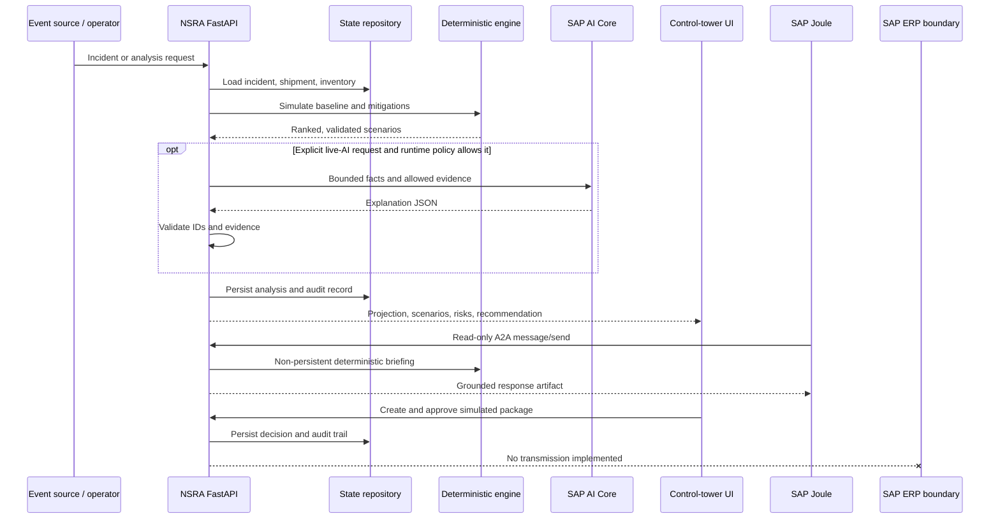

# Integration architecture and status

**Evidence date:** 2026-10-13

This document explains how NSRA components interact, where external platforms enter the workflow, and which boundaries are live, emulated, or intentionally disabled.

## Integration principles

1. **Deterministic facts first.** Inventory projections, feasibility, quantities, downtime, costs, and ranking are calculated in Python.
2. **AI explains; it does not decide.** SAP AI Core receives bounded computed facts and may only explain the existing recommendation.
3. **Humans approve simulated actions.** No connector may bypass the approval workflow.
4. **External state is explicit.** Configured credentials are not equivalent to a verified live call.
5. **Secrets remain outside Git.** `.env`, Cloud Foundry runtime variables, and service keys are never documentation inputs.
6. **Production fails closed.** Cloud mode requires PostgreSQL, and live AI requests are disabled by default for public traffic.

## End-to-end flow



## Current status matrix

| Component | Status | What has been verified | What is still missing |
|---|---|---|---|
| FastAPI application | **Deployed and healthy** | Public `/health`, `/api/v1/status`, integration health, and agent card responded on 2026-10-13 | Authentication, rate limiting, SLOs, and current-branch redeployment |
| Deterministic engine | **Local verified** | Hourly simulation, constraints, scenario ranking, fallback, and reference outputs | Calibration against real operational history |
| Local SQLite | **Local verified** | State persists across local process restarts | Not suitable for the cloud target or horizontal scaling |
| PostgreSQL repository | **Implemented** | Repository, TLS check, configuration, migration, and tests | Managed endpoint, cloud configuration, restage-survival proof |
| SAP AI Core | **Live verified, restricted** | A controlled GPT-5.4 inference succeeded previously; status records verification | Public live calls remain disabled; quota, latency, and failure monitoring are not operationalized |
| SAP Joule | **Live verified, read-only** | Tenant capability previously returned an NSRA briefing; public A2A card is reachable | Destination authentication hardening, lifecycle automation, and regression verification after redeploy |
| AWS events | **Locally emulated** | EventBridge payload normalization, idempotent ingestion, and Lambda-shaped handler | AWS account resources, IAM, EventBridge rule, Lambda deployment, DLQ, and live evidence |
| SAP ERP adapter | **Payload mapping only** | Approved draft can be mapped to a clearly simulated SAP-shaped payload | S/4HANA sandbox, authenticated API, idempotency, reconciliation, rollback, and business authorization |

## FastAPI and web application

The FastAPI process serves both the JSON API and the first-party HTML/CSS/JavaScript application. This same-origin architecture avoids a separate frontend deployment and eliminates cross-origin configuration for the current scope.

Key boundaries:

- `/health` validates the active state store.
- `/api/v1/status` publishes non-sensitive runtime facts.
- `/api/v1/integrations/health` separates operational, verified, emulated, and disabled components.
- `/docs` exposes the generated OpenAPI explorer.
- `/.well-known/agent.json` advertises the read-only A2A agent.
- `/a2a` handles the constrained Joule `message/send` interaction.

Every HTTP response receives an `x-trace-id`. Error responses use a structured envelope and avoid returning internal exception details or credentials.

## Persistence: SQLite and PostgreSQL

### Local mode

Local development defaults to SQLite at `.nsra-local/nsra-state.sqlite3`. It is durable across normal local restarts, ignored by Git, and safe for one developer or a deterministic demo.

### Cloud target

The Cloud Foundry manifest sets:

```text
APP_ENV=production
NSRA_STATE_BACKEND=postgresql
NSRA_STATE_PERSISTENCE=durable-cloud
NSRA_POSTGRES_SSLMODE=require
```

The repository resolves PostgreSQL from `DATABASE_URL`, `POSTGRES_URL`, or a compatible PostgreSQL binding in `VCAP_SERVICES`. If production requires PostgreSQL and no DSN is available, application startup fails rather than silently falling back to SQLite.

### Current deployment drift

The public deployment verified on 2026-10-13 reports `engine: sqlite` and `scope: ephemeral-instance`. Therefore the running revision predates or does not contain the enforced PostgreSQL configuration. Provision a managed database and redeploy the current branch before relying on cloud persistence.

## SAP AI Core

### Purpose

SAP AI Core augments the deterministic result with a concise, grounded explanation suitable for an operator. It is not used to calculate inventory, choose a scenario, or authorize a transaction.

### Request path

1. NSRA obtains an OAuth client-credentials token from the configured SAP authentication URL.
2. It calls the configured Generative AI Hub deployment.
3. The prompt contains only the computed baseline, scenarios, allowed recommendation ID, and evidence IDs.
4. The response must be valid JSON.
5. NSRA rejects any response that changes the deterministic recommendation or references unknown evidence.
6. Timeout, authentication, invalid JSON, or validation failure activates the deterministic fallback.

### Required configuration names

| Variable | Function |
|---|---|
| `SAP_CLIENT_ID` | OAuth client identity |
| `SAP_CLIENT_SECRET` | OAuth secret; never print or commit |
| `SAP_AUTH_URL` | SAP OAuth base or token URL |
| `SAP_AI_API_URL` | SAP AI Core inference API base |
| `SAP_RESOURCE_GROUP` | AI Core resource group, normally `default` |
| `SAP_GPT_DEPLOYMENT_ID` | Approved model deployment identifier |
| `SAP_AI_API_VERSION` | Inference API version |
| `SAP_AI_LIVE_VERIFIED` | Records that a controlled live check completed |
| `NSRA_LIVE_AI_REQUESTS_ENABLED` | Explicitly allows request-time live inference |

Production defaults `NSRA_LIVE_AI_REQUESTS_ENABLED` to false. This protects quota and prevents unauthenticated public traffic from creating inference cost.

## SAP Joule and A2A

SAP Joule and SAP AI Core serve different roles:

- **SAP AI Core** is an optional model inference service used inside the NSRA analysis workflow.
- **SAP Joule** is the conversational user entry point. It calls NSRA's read-only A2A endpoint and presents the deterministic briefing.

The A2A handler is deliberately constrained:

- only JSON-RPC 2.0 `message/send` is accepted;
- text is bounded before processing;
- an explicit incident ID is honored, otherwise the active highest-priority incident is selected;
- analysis runs with `persist=False`;
- it cannot create drafts, approve responses, change inventory, call ERP, or trigger public SAP AI inference; and
- every response states that data is synthetic and human approval is required.

The capability source is under `joule/nsra_supply_resilience`. The BTP destination helper creates `NSRA_SUPPLY_AGENT_A2A` and points it to the deployed `/a2a` route. The current destination uses `NoAuthentication`; this is acceptable only for the read-only synthetic hackathon boundary and must be replaced with an authenticated design before production use.

## AWS event integration

`integrations/aws_events.py` implements a side-effect-free contract adapter:

1. normalize an EventBridge-compatible envelope;
2. map it into the canonical Pydantic incident request;
3. use the event/incident ID as an idempotency key;
4. call the same service used by the HTTP API; and
5. return a Lambda-shaped response.

No `boto3` call or AWS resource is used. A production implementation still requires:

- an EventBridge event bus and schema;
- least-privilege IAM roles;
- a Lambda or equivalent consumer;
- retry and dead-letter policy;
- API/private-network connectivity; and
- correlation, metrics, and live-event evidence.

## SAP ERP execution boundary

`integrations/sap_adapter.py` maps an approved NSRA draft to a reviewable SAP-shaped payload. The payload contains `simulationOnly: true`; the adapter performs no authentication and no network request.

A real writeback should not be added until the team has:

- access to an S/4HANA sandbox and the exact business API;
- end-user authentication and role-based approval;
- idempotency and duplicate-document prevention;
- asynchronous execution status and reconciliation;
- compensating-action or rollback guidance;
- an immutable business audit trail; and
- a reviewed kill switch.

## Failure behavior

| Failure | Expected behavior |
|---|---|
| SAP AI credentials absent | Deterministic mode remains available |
| SAP AI timeout or invalid response | Recommendation is retained in fallback mode |
| PostgreSQL unavailable in enforced cloud mode | Health/startup fails; no silent SQLite fallback |
| Duplicate incident event | Existing incident is returned; no duplicate created |
| Duplicate draft request with same key | Existing draft is returned |
| Stale or second approval | Request is rejected with conflict status |
| Joule requests unsupported method | Structured A2A JSON-RPC error |
| SAP ERP unavailable | No effect because writeback is not implemented |

## Verification commands

Use the commands in [Operations Guide](OPERATIONS.md) to reproduce local evidence. Use [Cloud Deployment](CLOUD_DEPLOYMENT.md) for the secured deployment sequence. Never paste command output containing secrets into an issue, commit, or chat.
