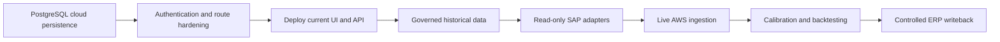

# Product and engineering roadmap

This roadmap prioritizes the work required to move NSRA from a strong hackathon implementation to a secure, supportable production system. Priorities reflect operational risk, not visual novelty.

## Priority 0 — secure and stabilize the cloud runtime

These items block any claim of production readiness.

### 1. Deploy durable PostgreSQL state

**Work**

- Provision an approved managed PostgreSQL database with TLS.
- Restrict network access and rotate initial credentials.
- Run the connection check and reviewed SQLite migration if state must be preserved.
- Configure Cloud Foundry runtime variables and deploy the current branch.
- Test concurrent writes, restage survival, backup, and restore.

**Acceptance criteria**

- `/api/v1/status` reports `postgresql`, `persistent: true`, and `durable-cloud`.
- Analyses, drafts, decisions, and audit records survive restage.
- Backup restoration is demonstrated in a non-production environment.
- Database credentials are absent from Git, logs, API responses, and screenshots.

### 2. Add authentication and authorization

**Work**

- Integrate SAP BTP XSUAA or the approved identity provider.
- Define roles such as Viewer, Planner, Approver, Integration Operator, and Administrator.
- Protect incident creation, analysis execution, draft creation, decisions, reset, and integration operations.
- Enforce separation of duties server-side using authenticated identity, not free-text actor names.
- Disable `/api/v1/demo/reset` outside explicit demo environments.

**Acceptance criteria**

- Anonymous users cannot mutate state.
- A planner cannot approve their own package.
- Authorization decisions are audited with stable user identity.
- Security tests cover missing, expired, and insufficient credentials.

### 3. Harden public and A2A traffic

**Work**

- Replace the `NoAuthentication` destination design with an approved authenticated route.
- Add request-size limits, rate limits, replay protection where appropriate, and strict content types.
- Define CORS, proxy, TLS, and security-header policies.
- Add a production kill switch for AI and external integrations.

**Acceptance criteria**

- Only authorized Joule/BTP callers can use the A2A endpoint.
- Abuse controls are observable and tested.
- The app remains functional in deterministic mode when every optional integration is disabled.

## Priority 1 — connect trustworthy operational data

### 4. Establish canonical data contracts

Create versioned schemas for:

- facilities, warehouses, ports, and suppliers;
- materials, units of measure, and safety stock;
- on-hand, reserved, blocked, and in-transit inventory;
- purchase orders, stock-transfer orders, and shipment milestones;
- production demand, bill-of-material dependencies, and line criticality;
- supplier capacity, lead time, minimum order quantity, and expedite constraints; and
- incident, weather, port, carrier, and route risk signals.

Every record should carry source system, source timestamp, effective timestamp, timezone, unit, currency, quality flag, and lineage ID.

### 5. Start with governed historical extracts

Live ERP access is not required for the first realistic validation. Use approved, sanitized CSV extracts with the same canonical schema:

1. export historical data from an authorized source;
2. remove personal, contractual, and secret fields;
3. validate units, timestamps, identifiers, missing values, and duplicates;
4. place non-sensitive samples in a controlled data location, not automatically in Git;
5. ingest through an adapter rather than changing optimizer code; and
6. compare modeled outcomes against known incidents.

Public datasets can enrich geography, weather, port, or maritime context, but they should not be presented as the company's inventory or shipment truth.

### 6. Build read-only SAP business-data adapters

**Work**

- Confirm whether the target is S/4HANA Cloud, on-premise S/4HANA, or another SAP system.
- Select approved APIs or CDS/OData views for stock, materials, plants, orders, and shipments.
- Add pagination, delta handling, retry, timeout, circuit breaking, and schema validation.
- Store source references and freshness in every analysis.

**Acceptance criteria**

- A read-only synchronization runs without exposing credentials.
- Reconciliation reports missing and mismatched records.
- UI freshness and provenance are visible to operators.
- Synthetic mode remains available for tests and demonstrations.

### 7. Deploy live AWS event ingestion

**Work**

- Provision EventBridge, Lambda, IAM, log groups, metrics, and a dead-letter queue through infrastructure as code.
- Define the versioned event schema and idempotency policy.
- Connect the consumer to a private or authenticated NSRA endpoint.
- Add replay tooling and failure dashboards.

**Acceptance criteria**

- One controlled event creates exactly one incident.
- Duplicate and out-of-order events are handled predictably.
- Failed events reach the dead-letter queue with traceable diagnostics.
- End-to-end latency and error rate are measured.

## Priority 1 — operate the system reliably

### 8. Observability and service management

- Emit structured JSON logs with trace, incident, analysis, draft, and user IDs.
- Add metrics for request latency, scenario runtime, AI calls, fallback rate, database health, approval age, and event lag.
- Add distributed traces across event ingestion, API, database, and AI calls.
- Define dashboards, alerts, service-level indicators, and runbooks.
- Add audit retention, backup retention, and incident-response procedures.

### 9. Delivery pipeline

- Add CI for tests, linting, secret scanning, dependency audit, and documentation link checks.
- Build a repeatable Cloud Foundry deployment pipeline with environment approvals.
- Produce an immutable release identifier and expose it through `/api/v1/status`.
- Add database migration versioning.
- Create preview or staging validation before production promotion.

### 10. Browser and accessibility automation

- Add Playwright or an equivalent end-to-end suite for navigation, filters, charts, approval, exports, and responsive layouts.
- Add keyboard navigation, focus-order, screen-reader, contrast, reduced-motion, and zoom tests.
- Add screenshot regression checks for key desktop and mobile views.

## Priority 2 — deepen decision intelligence

### 11. Calibrate the optimizer

- Replace reference costs and capacities with governed master data.
- Model route calendars, handling time, supplier capacity, minimum lots, expiration, substitution, and multi-material dependencies.
- Introduce probabilistic lead-time and demand distributions.
- Quantify confidence and sensitivity instead of returning a single point estimate only.
- Backtest recommendations against historical disruption outcomes.

### 12. Expand network risk analytics

- Multi-tier supplier and port dependencies.
- Vessel, weather, congestion, and geopolitical risk feeds.
- Network bottleneck and single-point-of-failure detection.
- Portfolio-level budget allocation across simultaneous incidents.
- Scenario comparison across cost, downtime, emissions, and service level.

### 13. Carefully introduce SAP ERP execution

Real writeback should be the final integration stage, not the next shortcut.

Required controls include:

- approved S/4HANA sandbox and exact business API;
- authenticated service identity and least-privilege authorization;
- idempotency key mapped to the created SAP document;
- preflight validation and human confirmation of final payload;
- asynchronous status, reconciliation, and duplicate prevention;
- error handling and compensating process;
- immutable audit evidence; and
- environment-level kill switch.

Begin with a non-posting validation or simulation API if the SAP landscape supports one.

## Priority 2 — product refinement

- Saved views and role-specific home pages.
- Notification center and approval escalation.
- Collaborative comments and decision rationale history.
- Configurable dashboard layouts and export packs.
- Data freshness indicators on every chart and table.
- Scenario assumption editor with versioned change history.
- Mobile approval experience after authentication exists.

## Suggested execution sequence

Work on observability, CI/CD, and browser automation in parallel with every stage rather than postponing them until the end.

## Production-readiness definition

NSRA should be called production-ready only when:

- all user and machine access is authenticated and authorized;
- PostgreSQL durability, backup, restore, and concurrency are proven;
- live data has lineage, freshness, reconciliation, and quality controls;
- external integrations have timeouts, retries, metrics, alerts, and runbooks;
- numerical models are calibrated and backtested;
- accessibility, browser, API, security, and load tests pass in CI;
- SAP writeback, if enabled, is idempotent, reviewable, and reversible operationally;
- privacy, retention, and audit requirements are approved; and
- operators have completed a failure and recovery exercise.
