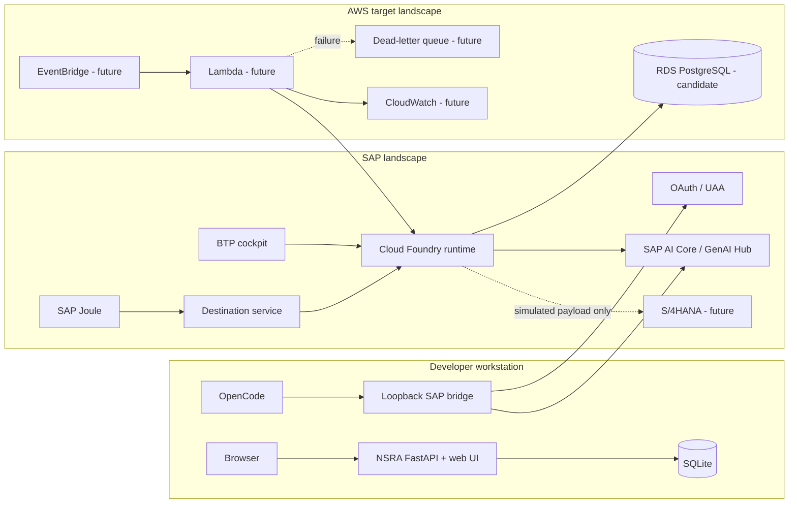
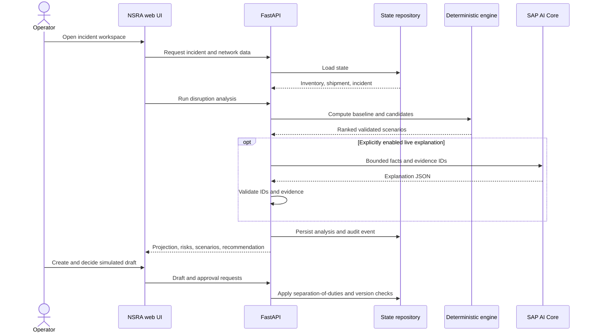
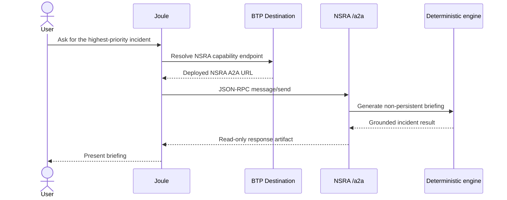

# NSRA system integration guide

This guide explains how the NSRA application, SAP services, AWS services,
persistence, and developer tooling fit together. It distinguishes implemented
runtime paths from emulated and future production paths.

## 1. System purpose and decision boundary

NSRA receives a supply disruption, projects inventory hour by hour, evaluates
bounded response scenarios, recommends the least-damaging feasible response,
and prepares a human-reviewable action package.

The deterministic Python engine owns numerical truth:

- available and safety stock;
- demand and stockout timing;
- route and sourcing feasibility;
- quantity allocation;
- response cost and modeled downtime;
- scenario ranking; and
- approval-state rules.

AI may explain these results but cannot replace scenario identifiers, quantities,
costs, feasibility, or approval decisions. No current integration creates a real
SAP purchase order, stock-transfer order, or inventory movement.

## 2. Deployment topology



Local NSRA and the local OpenCode bridge are separate processes. OpenCode is a
developer client for testing the SAP model deployment; the NSRA application does
not require OpenCode to run.

## 3. Component responsibility catalog

### NSRA application components

| Component | Responsibility | Current state |
|---|---|---|
| FastAPI | Serves API routes, UI assets, health, A2A, workflow, and validation | Implemented |
| Web control tower | Presents portfolio, network, inventory, scenarios, approvals, audit, and integration health | Implemented |
| Deterministic engine | Computes projections, feasibility, allocation, cost, downtime, and ranking | Implemented and tested |
| State repository | Persists incidents, analyses, drafts, decisions, counters, and audit records | SQLite local; PostgreSQL implementation available |
| SAP AI client | Sends bounded computed facts to the approved SAP model and validates its explanation | Implemented; live use policy-restricted |
| A2A handler | Gives Joule a read-only deterministic incident briefing | Implemented |
| AWS adapter | Normalizes EventBridge-shaped events and invokes the same incident service as the HTTP API | Locally emulated |
| SAP adapter | Builds a reviewable SAP-shaped payload after approval | Mapping only; no network call |

### SAP services

| Service | Function in NSRA | What it does not do |
|---|---|---|
| SAP BTP cockpit | Manages subaccount, entitlements, Cloud Foundry organization/space, service instances, and keys | It does not run the application by itself |
| Cloud Foundry | Builds, starts, scales, routes, and supplies runtime variables to the NSRA application | It is not the LLM and should not be used as durable file storage |
| OAuth/UAA | Exchanges the AI Core client identity and secret for a short-lived access token | A successful token does not prove inference or Joule capability health |
| SAP AI Core / Generative AI Hub | Hosts the approved model deployment used for grounded explanatory text | It does not compute or approve NSRA recommendations |
| Destination service | Stores the endpoint configuration Joule uses to find the deployed NSRA A2A route | It does not deploy the Joule capability or validate NSRA business logic |
| SAP Joule | Provides a conversational entry point for incident briefings | It cannot mutate NSRA state through the current A2A capability |
| A2A capability | Describes and invokes the constrained `message/send` contract between Joule and NSRA | It cannot create drafts, approve actions, or call ERP |
| SAP S/4HANA | Future governed source for inventory, material, purchase-order, and execution data | No sandbox or live writeback is connected today |

### AWS services in the target design

| Service | Planned function | Current state |
|---|---|---|
| EventBridge | Receives supply-chain events and routes matching events to the NSRA consumer | Contract emulated only |
| Lambda | Validates and normalizes an event, applies idempotency metadata, and calls NSRA | Handler shape emulated only |
| IAM | Grants the minimum permissions required by EventBridge, Lambda, logging, secrets, and networking | Not provisioned |
| Dead-letter queue | Retains events that remain unprocessable after retries for diagnosis and replay | Not provisioned |
| CloudWatch | Collects logs, metrics, alarms, event lag, error rate, and invocation evidence | Not provisioned |
| RDS PostgreSQL | Candidate durable cloud database reachable from Cloud Foundry over TLS | Repository support exists; endpoint not provisioned |

AWS is not needed for deterministic local use. Its production role is event
ingestion and potentially managed PostgreSQL, not scenario calculation.

## 4. End-to-end runtime flows

### 4.1 Operator and web application flow



If SAP AI Core is unavailable, the deterministic analysis remains usable and the
application records fallback mode.

### 4.2 Joule read-only flow



Joule login proves only user authentication. A successful answer additionally
depends on the capability deployment, destination, public route, A2A contract,
and user authorization.

### 4.3 SAP AI Core inference flow

1. NSRA validates that live inference is explicitly allowed.
2. The SAP client exchanges `SAP_CLIENT_ID` and `SAP_CLIENT_SECRET` at
   `SAP_AUTH_URL` using OAuth client credentials.
3. SAP returns a short-lived bearer token.
4. NSRA sends bounded facts to the deployment under
   `SAP_GPT_DEPLOYMENT_ID` and `SAP_RESOURCE_GROUP`.
5. The response must satisfy the expected schema and reference only allowed
   scenario and evidence identifiers.
6. Invalid, late, or unavailable output is discarded in favor of deterministic
   fallback text.

### 4.4 AWS event flow: target versus current implementation

Target production flow:

```text
External event producer
  -> EventBridge event bus and rule
  -> Lambda consumer
  -> schema validation and normalization
  -> authenticated NSRA incident endpoint
  -> idempotent incident creation
  -> logs/metrics in CloudWatch
  -> failed retries to DLQ
```

Current repository flow:

```text
scripts/simulate_event.py
  -> EventBridge-compatible JSON
  -> integrations/aws_events.py
  -> canonical incident service
  -> local NSRA API/state
```

No current path calls `boto3` or an AWS account.

### 4.5 Approved action and future ERP flow

The current workflow stops at an approved simulated draft. The SAP adapter adds
`simulationOnly: true` and performs no authentication or network request.

A future S/4HANA flow requires an approved sandbox, exact business API,
least-privilege identity, payload preflight, idempotency key, asynchronous status,
reconciliation, duplicate prevention, immutable audit evidence, and a kill
switch. Writeback should remain disabled until all controls are verified.

### 4.6 OpenCode developer bridge flow

```text
OpenCode
  -> local provider sap-local/sap-gpt54
  -> Bearer NSRA_PROXY_KEY
  -> 127.0.0.1:8765/v1/chat/completions
  -> bridge/proxy.py
  -> SAP OAuth token
  -> fixed SAP AI Core deployment
```

The bridge exists only to make an OpenAI-compatible local development interface.
It binds to loopback, verifies a workstation-local proxy key, removes the model
name supplied by the client, and uses the server-configured deployment. It is not
deployed with NSRA and must not be exposed to a network.

## 5. Data ownership and persistence

| Data | Owner/source today | Persistence |
|---|---|---|
| Reference facilities, routes, inventory, shipments | Versioned synthetic seed | `data/demo_seed.json` |
| Incidents and analyses | NSRA workflow | SQLite local or PostgreSQL target |
| Drafts, approvals, audit events | NSRA workflow | SQLite local or PostgreSQL target |
| AI access token | SAP UAA response | In-memory cache only |
| SAP client secret | Local `.env` or Cloud Foundry runtime environment | Never Git |
| OpenCode proxy key | Per-workstation setup script | Local `.env` only |
| Joule destination credentials | BTP service and Cloud Foundry tooling | Never Git |

SQLite is appropriate for one local process and reproducible demos. PostgreSQL
is required for durable cloud operation, concurrent access, restart survival,
backup, and controlled migration.

## 6. Configuration ownership

| Variable/group | Consumer | Purpose |
|---|---|---|
| `APP_ENV` | NSRA | Selects development or production policy |
| `NSRA_STATE_BACKEND` | Repository factory | Selects SQLite or PostgreSQL |
| `DATABASE_URL` | PostgreSQL repository | Private database connection string |
| `NSRA_POSTGRES_SSLMODE` | PostgreSQL tooling | Enforces the approved TLS mode |
| `SAP_CLIENT_ID`, `SAP_CLIENT_SECRET` | NSRA SAP client and bridge | OAuth client credentials |
| `SAP_AUTH_URL` | NSRA SAP client and bridge | OAuth authorization server |
| `SAP_AI_API_URL` | NSRA SAP client and bridge | AI Core inference API root |
| `SAP_GPT_DEPLOYMENT_ID` | NSRA SAP client and bridge | Approved model deployment |
| `SAP_RESOURCE_GROUP` | NSRA SAP client and bridge | AI Core resource group |
| `SAP_AI_API_VERSION` | NSRA SAP client and bridge | Inference API version |
| `NSRA_LIVE_AI_REQUESTS_ENABLED` | NSRA policy | Enables controlled request-time inference |
| `NSRA_PROXY_KEY` | Local bridge and OpenCode | Authenticates loopback bridge requests |
| `AWS_REGION` | Future AWS adapter/runtime | Selects AWS region without embedding it in code |

Credentials belong in the ignored `.env` for local use and approved runtime
secret configuration in cloud. A configured variable is not evidence that the
corresponding service call has succeeded.

## 7. Operational dependency map

| Capability | Required components |
|---|---|
| Local deterministic NSRA | `.venv`, FastAPI, seed data, SQLite |
| Local PostgreSQL mode | Local NSRA plus reachable TLS PostgreSQL and DSN |
| SAP-enhanced analysis | Local/cloud NSRA plus SAP OAuth and AI deployment |
| Joule briefing | Deployed NSRA route, A2A endpoint, destination, capability, authorized Joule user |
| OpenCode SAP model test | `.venv`, SAP credentials, local bridge, proxy key, current `opencode.json`, OpenCode |
| Live AWS ingestion | EventBridge, Lambda, IAM, authenticated NSRA route, logs, retries, DLQ |
| Real S/4HANA execution | Approved API and identity plus all approval, idempotency, reconciliation, and audit controls |

## 8. Failure isolation

| Symptom | Boundary to inspect first |
|---|---|
| NSRA does not become healthy | `.nsra-local/backend.stderr.log`, Python environment, state backend |
| Deterministic analysis works but explanation falls back | SAP OAuth, AI endpoint, deployment, quota, response validation |
| Joule login succeeds but gives no response | Capability, destination, public A2A route, tenant authorization |
| Browser at bridge root returns 404 | Expected; call `/health` |
| OpenCode says model unavailable | Local `opencode.json` discovery; request has not reached bridge |
| Bridge logs `/v1/responses` 404 | Wrong OpenCode SDK; use the tracked OpenAI-compatible template |
| Bridge returns 502 | SAP authentication, network, deployment, or upstream response |
| Duplicate AWS event | Verify event/incident idempotency key and consumer retry behavior |
| Cloud app loses state after restage | Runtime still uses ephemeral SQLite instead of PostgreSQL |

## 9. Verification levels

- **Configured**: required settings exist, but no external call has been proven.
- **Locally verified**: behavior ran against deterministic local data.
- **Live verified**: an authorized external service call succeeded and evidence
  was reviewed.
- **Deployed**: a runtime is reachable; integrations may still be disabled or
  emulated.
- **Production-ready**: security, durability, observability, recovery, load,
  authorization, and operational ownership have all been demonstrated.

Use [INTEGRATION_STATUS.md](INTEGRATION_STATUS.md) for current evidence and gaps,
[OPERATIONS.md](OPERATIONS.md) for commands, [CLOUD_DEPLOYMENT.md](CLOUD_DEPLOYMENT.md)
for BTP deployment, and [ROADMAP.md](ROADMAP.md) for the production path.
